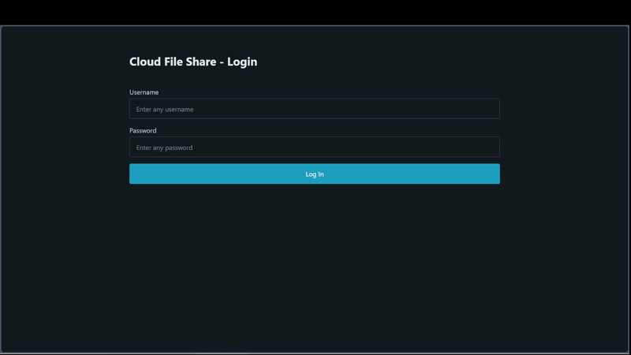

# Cloud File Upload Demo (Flask + AWS)

A serverless web application that allows authenticated users to upload files to Amazon S3. Upon upload, an AWS Lambda function is triggered to log the file metadata in DynamoDB and send a confirmation email via Amazon SES.

## 🎥 Project Demo


## 🏗️ Architecture & Tech Stack
* **Frontend:** HTML/CSS (Jinja2 Templates)
* **Backend:** Python, Flask, Boto3
* **Cloud (AWS):** 
  * **S3:** File storage
  * **Lambda:** Event-driven serverless computing
  * **DynamoDB:** NoSQL database for file metadata
  * **SES:** Simple Email Service for notifications

## ☁️ AWS Resource Requirements
To run this project, you will need an AWS account with the following resources configured:
1. An **S3 Bucket** to store uploaded files.
2. A **DynamoDB Table** (e.g., `FileUploadLogs`) with a Primary Key to store metadata.
3. A **Lambda Function** triggered by S3 object creation to process data and trigger SES.
4. An **SES Verified Identity** (email address) to send outbound notifications.
5. IAM permissions configured via the AWS CLI (`aws configure`) on your local machine.

## 🛠️ Local Development Setup

### 1. Prerequisites
Before you begin, ensure you have the following installed:
* Python 3.x
* Git
* AWS CLI (Configured with your IAM credentials using `aws configure`)

### 2. Clone the Repository
Navigate to your desired folder in the terminal and clone the project:
```bash
git clone https://github.com/Brandyn1234/cloud-file-upload-demo.git
```
```bash 
cd cloud-file-upload-demo
```

### 3. Set Up the Virtual Environment
Create an isolated Python environment so dependencies don't conflict with your system.

**For Windows (PowerShell/CMD):**
```powershell
python -m venv venv
.\venv\Scripts\activate
```
*(Note: If you are using Git Bash or a Unix-style terminal on Windows, use `source venv/bin/activate` instead).*

**For macOS/Linux:**
```bash
python3 -m venv venv
source venv/bin/activate
```

### 4. Install Dependencies
With the virtual environment active (you should see `(venv)` in your terminal prompt), install the required packages:
```bash
pip install -r requirements.txt
```

### 5. Configure Environment Variables
Create a file named `.env` in the root folder of the project. Add your specific AWS and app configurations to this file:
```env
AWS_DEFAULT_REGION=us-east-1
S3_BUCKET_NAME=your-s3-bucket-name
DYNAMODB_TABLE_NAME=your-dynamodb-table-name
LAMBDA_FUNCTION_NAME=your-lambda-function-name
APP_PASSCODE=your-secure-passcode
```
*Note: The `.env` file is included in `.gitignore` and should never be pushed to version control.*

### 6. Run the Application
Start the local Flask server:
```bash
python app.py
```
Open your web browser and navigate to `http://localhost:5000` to use the application.